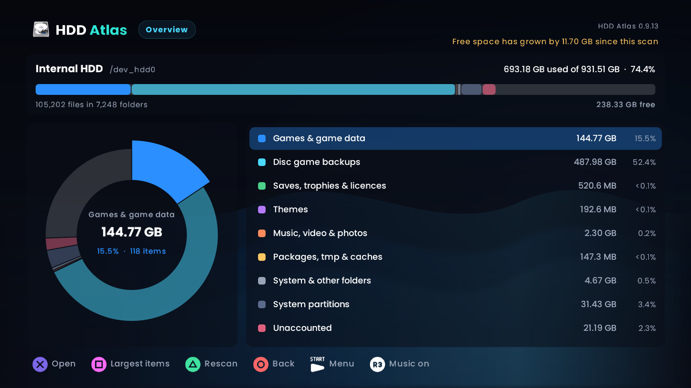
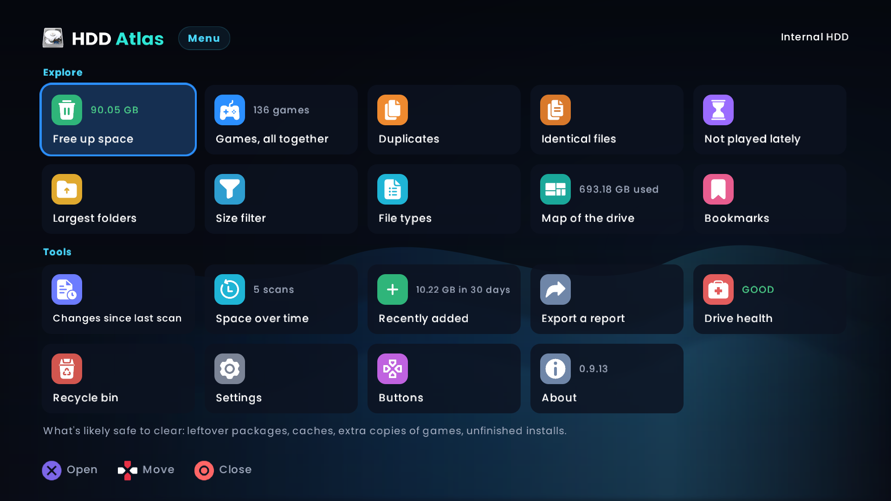
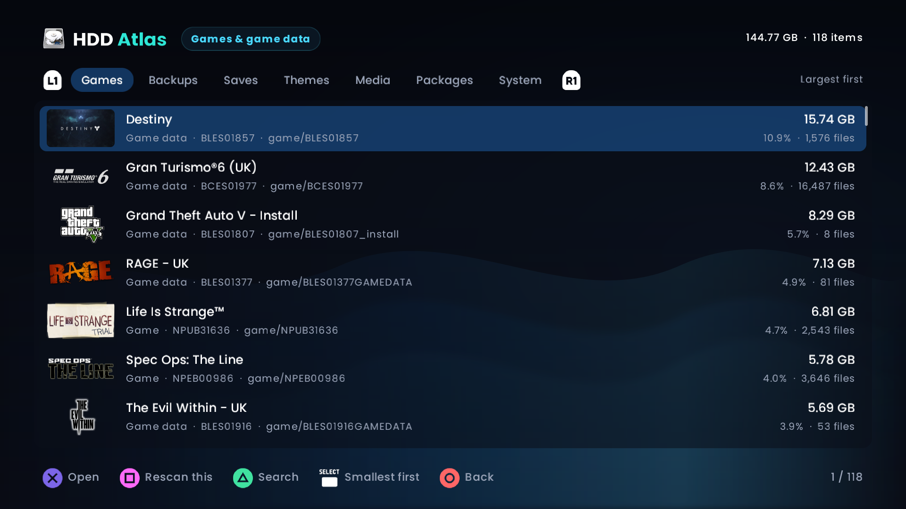
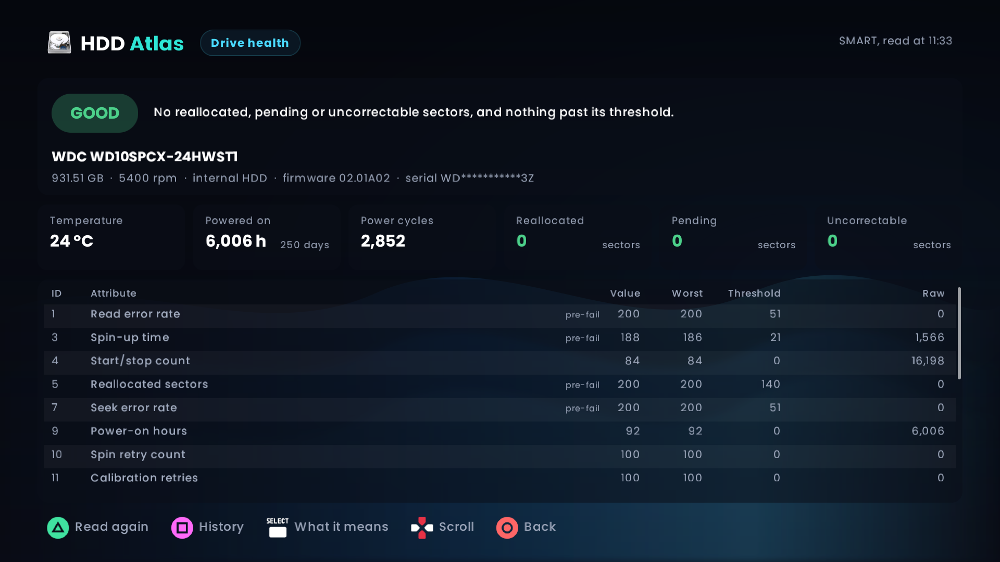

# HDD Atlas

A PS3 homebrew app (PSL1GHT, HEN and CFW) that shows what's using the HDD's space (and USB drives', FAT32 or NTFS). It scans a drive on a background thread and groups what it finds into categories: games, disc backups, saves/trophies/licences, themes, media, packages/tmp, system folders, the system's own partitions, and unaccounted space. The overview is a ring chart and a list. From there you open a category's items (Square rescans just that category) (games and saves by title, with their icons), the largest items and files, and any folder's contents down to the last file, with folder sizes from the scan. Every list sorts and searches by name.

| | |
|---|---|
|  |  |
|  |  |

It opens with an intro, then a start screen: the drive, how full it is and when it was last scanned, and Scan, Last scan, Tools and Settings. Nothing's scanned until you ask (unless Settings says to). START on the overview (or Tools) opens the menu, a grid of tiles with a figure on each (backing out of a page returns to it): **free up space** (leftover packages and ones not installed yet, webMAN's and other apps' caches, extra copies of games, installs the system didn't finish, downloads and queued installs, system updates, updates and saves for games that aren't here, each with why; Square keeps a row off it), **games, all together** (install, backups, saves and trophies added up by title ID; disc images' titles and icons are read from inside them), **duplicates** (also against the other drives' last scans), **identical files** (byte for byte, where you keep things), **size filter** (over a size, untouched for a while), **not played lately** (games by their newest save), **largest folders** (at any depth), **file types**, **map of the drive** (a treemap you can go into), **bookmarks** (Square in a folder), **space over time** (each scan's used space by category), **recently added** (what's new or changed in the last week, month, three months or year), **buttons** (a guide), **changes since the last scan** (what grew, shrank, appeared or went), **export a report** (text and CSV, to the HDD or a USB drive), **Recycle bin** (deletes wait there 7 days by default, on the same drive, to be put back), **Drive health** (the internal drive's SMART data, read-only and journaled against freezes; each reading is kept, and a counter that grew is pointed out; an SSD shows its life left, from the attribute its maker uses for it, with a warmer temperature limit and its own wording; a drive wearing out gets a What to do page (X: copy saves, licences, act.dat and trophies first, delete what isn't needed, don't rescan, replace it, with ps3.world/upgrade-storage for the swap); SELECT explains it all, pre-fail and old-age included), **Settings** (language: 16 of them, following the PS3's by default; music level, sound effects, 1024 or 1000 sizes, rescanning by itself at start or when a USB drive is plugged in, dimming the screen after a while without a button, an accent colour, allowing deletes, the recycle bin's days) and **About**. With deleting allowed, START on a row deletes it, one at a time, after holding X for 2 seconds: only disc images, folder backups in GAMES, leftover packages, ROMs, webMAN's cache, installs the system left unfinished (game/_INST_*, game/_DEL_*: checked first that nothing's still writing to them), and system update files (a backed-up disc's PS3_UPDATE, an updater/<NN>/*.pup) (installed games, saves and media stay with the XMB; webMAN's and prepISO's stubs for games on NTFS drives, `tmp/wmtmp/*.ntfs[...]`, and disc images' `.dkey` files stay too: webMAN needs them to list and mount those games). With the recycle bin on (the default), a delete is a move into the bin on the same drive, freed when the bin's emptied; every delete is logged to USRDIR/deletions.log. R3 turns the music off or on anywhere. A scan stuck inside a call to the drive (a failing disk or SSD that never answers) is noticed: after 30 seconds without a new folder or file, where it's waiting goes in the log; after 5 minutes it's given up, and a panel says where it was stuck and to send the log to ps3.world/contact (nothing's sent by the app: it has no network). Until that call comes back, the drive is left alone (its menu, lists, deletes and another scan say to restart the console; if it's an NTFS drive, every NTFS drive is, as they share one lock) and the rest of the app carries on; Circle stops a scan even in the middle of a big folder, and a folder that never ends (a damaged FAT32 one whose chain loops) is cut off at 200,000 entries. Read errors on the internal drive (I/O errors, bad sectors usually: not locked folders) get a panel too, whether the scan skipped what it couldn't read or couldn't finish at all, pointing to Drive health (Triangle opens it).

**NTFS drives.** The PS3 only mounts FAT32 drives itself. HDD Atlas mounts an NTFS drive's first NTFS partition as `/ntfsN:` (with libntfs_ext), shown as NTFS 0-7 beside USB 000-007; L1/R1 reach it a few seconds after it's plugged in. Everything works on it as on a USB drive, recycle bin included, except a report (written to FAT32 drives and the HDD only). A drive Windows didn't close cleanly (pulled out without Safely Remove, or Fast Startup / hibernation) is mounted read-only: it's scanned, but nothing on it is deleted or put back until it's been closed cleanly on a PC. exFAT isn't read.

The last scan of each drive is cached in USRDIR, so the app reopens instantly. It writes nothing outside its own USRDIR except what you ask for: deletes, and a report saved to a USB drive.

Title ID `HDAT00001`. Log: `USRDIR/hddatlas_log.txt`. Licence: GPL-2.0.

| | |
|---|---|
| `sh tools/build.sh` | builds the PKG in place to `out/HDDAtlas-v<version>.pkg` (toolchain in `/opt/ps3`) |
| `sh tools/host-test.sh` | the scanner on the PC under ASan/UBSan, plus screenshots of the screens (16:9 and 4:3) |
| `src/scan.c`, `src/sfo.c` | the scanner: iterative, bounded memory, read-only; folder sizes, titles (PARAM.SFO, TROPCONF.SFM); the cache; the path probe in the log |
| `src/ps3/fsx_ps3.c` | read-only filesystem calls on the console; free space and total |
| `src/ps3/ntfs_ps3.c`, `src/ps3/ntfs_vol.c` | NTFS drives: mounting them as they're plugged in, and the calls fsx, del and plat send `/ntfsN:` paths to; `src/thirdparty/libntfs_ext` (Estwald's, unchanged, `FROM.txt`) |
| `src/ui_home.c` | the intro and the start screen |
| `src/bin.c`, `src/finds.c` | the recycle bin's places and list (its moves are del.c's); identical files and a game's parts, looked for on workers |
| `src/ui.c`, `src/ui_list.c` | the overview and drives; the lists (items, largest, folders, games, duplicates, not played, bookmarks) |
| `src/health.c`, `src/ui_health.c`, `src/ps3/ata_ps3.c` | drive health: SMART decoding and verdict, the screen, the lv2 storage calls |
| `src/del.c`, `src/ui_delete.c`, `src/ps3/del_ps3.c` | deleting: the allow-list and the deleter, the lock and the panels, the only two calls that remove anything |
| `src/ui_map.c`, `src/history.c` | the map of the drive; each scan's totals kept for Space over time |
| `src/games.c`, `src/iso.c` | games by title ID (totals, duplicates, what's spare); disc images' PARAM.SFO / SYSTEM.CNF |
| `src/ui_menu.c`, `src/report.c`, `src/settings.c`, `src/i18n.c` | the START menu, Settings and About; the report; the settings file; the language (data/lang, `tools/strings.py --check <code>` lists what a language lacks, `tools/lang-add.py` adds them) |
| `src/ui_kit.c`, `src/ring.c`, `src/icons.c` | PS3 World's helpers, the ring chart, ICON0s read on a worker |
| `src/gfx.c`, `font.c`, `input.c`, `jobs.c`, `lang.c`, `src/ps3/*` | copied from PS3 World (`video_ps3.c` and `main_ps3.c` changed; see their headers) |
| `docs/` | the release notes, the hardware test checklist, the screenshots, and the two PS3 HDD research reports the rules come from |

Made by daedra000 and Claude (Anthropic).

The hard disk icon (the XMB's and the app's): "Internal Clear" by Rick Patrick, from [SoftIcons](https://www.softicons.com) (`art/icon-hdd.png`); `python3 tools/make-art.py` makes `art/ICON0.PNG` and `data/logo.png` from it. The XMB background: `art/PIC1.PNG`.

Menu icons: by Tanah Basah, from [Flaticon](https://www.flaticon.com) (`art/menu-icons/`, the IDs in `data/licenses/ICONS.txt`); `python3 tools/make-menu-icons.py` makes them white into `data/menu/`, for the START menu and the start screen.

Music: "Relaxing Music (Part 1)" by [Piotr Witowski](https://pixabay.com/users/relaxingtime-17430502/) from [Pixabay](https://pixabay.com/). R3 turns it off or on. `sh tools/make-music.sh` makes `data/music.ogg` from the original in `art/music/` (not in git), with ffmpeg. It's decoded by stb_vorbis (public domain).

NTFS: [libntfs_ext](https://github.com/Estwald/libntfs_ext) by Estwald (from NTFS-3G and libext2fs, GPL-2.0), in `src/thirdparty/libntfs_ext`, built by `Makefile.ps3` with its own flags.
